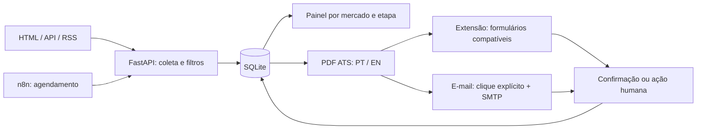

# JobFlow Local

Central local para pesquisar vagas, aplicar filtros, preparar currículos ATS e acompanhar candidaturas com intervenção humana quando necessário.

O projeto nasceu de uma rotina real de busca por emprego. A edição pública usa exemplos fictícios, sem credenciais, currículos ou histórico pessoal.


*Organização, automação e controle total para a sua busca por emprego.*


## Demonstrações

**Demonstração no computador:**

https://github.com/user-attachments/assets/30091c54-ae5b-4bdd-bd14-6b402f5a9369

**Demonstração responsiva no celular:**

https://github.com/user-attachments/assets/b73ecad4-a5a2-4b78-8d40-0f6801a37071

Os vídeos mostram a interface em uso. A instalação pública começa com dados fictícios e os recursos de envio desligados para configuração e teste.

## Funcionalidades

- Interface dark com mercados **Brasil** e **EUA / Canadá** e cartões por vaga.
- Remotas no Brasil inteiro; presenciais sujeitas aos filtros de localização e salário.
- Fontes internacionais globais/LATAM e revisão de elegibilidade geográfica. A categoria não comprova a sede da empresa.
- Novas oportunidades, Fila automática, Ação necessária, Envios automáticos, Enviadas/histórico, Pendentes e Ignoradas.
- PDFs em português e inglês, com dados revisados, texto selecionável e nomes curtos.
- Fila com tentativa identificada, prevenção de duplicatas e integração com a [extensão 3.0.0](https://github.com/mendxcyber/jobflow-browser-extension).
- Registro de envio exige evidência da página ou aceitação SMTP; guarda data, mensagem e SHA-256 do PDF.
- Botão de envio por e-mail, com destinatário visível e PDF regenerado antes do envio.
- Banco de respostas confirmadas e seleção opcional por IA local via Ollama.
- Estado da extensão, diagnóstico de coleta, notificações e workflow n8n para buscas periódicas.

## Funcionamento e evolução planejada

O JobFlow é um **software local em evolução contínua**. O n8n orquestra uma nova varredura das fontes configuradas a cada seis horas; depois, o serviço aplica filtros, evita duplicatas, organiza as oportunidades e prepara os currículos ATS em português ou inglês.

Nos formulários já compatíveis, a extensão pode preencher os dados, anexar o currículo e concluir o envio quando o modo automático estiver habilitado. As próximas atualizações ampliarão essa cobertura para que mais candidaturas compatíveis sejam preparadas e enviadas sem exigir que cada anúncio seja aberto e avaliado manualmente.

O controle continuará sendo do usuário: será possível manter a revisão manual antes do envio, usar a fila automática, enviar por e-mail ou abrir a vaga. CAPTCHA, login expirado, testes e perguntas sem resposta confirmada permanecem em **Ação necessária**, sem inventar informações para avançar.



## Instalação

Requisitos: Docker com Compose e virtualização. Python 3.12 é opcional para preparar a configuração.

```bash
git clone https://github.com/mendxcyber/jobflow-local.git
cd jobflow-local
python scripts/setup.py
# Revise config/candidato.json e config/filtros.json.
docker compose up -d --build
```

Sem Python, copie os três arquivos `*.example.json` de `config/` para os mesmos nomes sem `.example` e crie `dados` e `curriculos`.

Abra http://localhost:8090 e http://localhost:5678. Cadastre o usuário local do n8n, importe `n8n/workflow.json`, teste a busca e ative o agendamento. As portas ficam em `127.0.0.1`; ajuste o Compose se já estiverem ocupadas. Não exponha a aplicação à internet.

## Configuração

| Arquivo | Função |
| --- | --- |
| `config/candidato.json` | Perfil em português; `en` contém o perfil inglês revisado |
| `config/filtros.json` | Modalidade, salário, contrato, localização e restrições; exemplo com foco de entrada/RJ |
| `config/fontes.json` | Coletores automáticos e links manuais por mercado |
| `config/respostas.json` | Respostas confirmadas em português; inicia vazio |
| `config/respostas-en.json` | Respostas confirmadas em inglês; inicia vazio |
| `config/automacao.json` | IA opcional, desligada por padrão na edição pública |

A versão inglesa não é inventada pelo modelo: preencha `en`. Resumos e ordem das experiências por área podem ser definidos em `en.summaries` e `en.experience_order`.

Os PDFs ficam em subpastas curtas de `curriculos/`. Para uma segunda pasta, monte-a no contêiner e defina `PERSONALIZED_DIR`. Nenhum caminho pessoal do autor está fixado no código público.

## Automação e e-mail

Instale a extensão complementar e configure a URL local. **Preenchimento e envio iniciam desligados na extensão pública**; teste antes de habilitar. Navegador e computador precisam estar ligados, com as sessões dos portais autenticadas.

CAPTCHA, login, testes, perguntas sem fatos confirmados, anexo não reconhecido e falta de comprovante interrompem o fluxo. Formulários prontos com envio final desligado aparecem em Novas oportunidades.

Configure SMTP em http://localhost:8090/settings/email ou pelas variáveis do `.env.example`. O botão mostra o destinatário e fica desabilitado sem conta configurada. As credenciais ficam em `dados/smtp-private.json`, com permissões restritas no contêiner: não compartilhe esse volume.

Aceitação SMTP **não comprova entrega ou leitura**. Confira sua caixa antes de repetir um envio incerto. Histórico antigo sem evidência não é reclassificado como automático.

## IA local opcional

```bash
docker compose --profile ai up -d ollama
docker compose exec ollama ollama pull qwen2.5:1.5b
# Ative ai.enabled em config/automacao.json.
```

O modelo seleciona um fato do banco revisado para responder uma pergunta equivalente. Não cria experiência, certificações ou autorização de trabalho nem responde provas. Sem resposta disponível, exige intervenção.

Não há API paga obrigatória. Há consumo de RAM, CPU, disco, internet e energia. Ollama tem limite de 3 GB e descarrega o modelo após inatividade. Para parar: `docker compose stop ollama`.

## Fontes e limites

RioVagas, Gupy, Glassdoor, Vagas.com, InfoJobs, Trabalha Brasil e GeekHunter dependem dos coletores e conteúdo disponível. Remote OK e Remotive usam APIs públicas; We Work Remotely usa RSS. Outros portais configurados são links manuais. Os feeds têm cache de seis horas.

“Remoto” não significa contratação mundial. Restrições claras são filtradas; dados ambíguos ficam pendentes. O RSS do We Work Remotely pode divergir dos países aceitos na página: confira a elegibilidade antes de aprovar.

Bloqueios, limites e mudanças de HTML podem impedir coleta ou envio. As regras e a detecção por texto são heurísticas. Não há compatibilidade universal, garantia de contratação ou aprovação ATS. Respeite as condições de cada portal.

## Desenvolvimento e testes

```bash
python -m pip install -r worker/requirements.txt
python scripts/setup.py
CONFIG_DIR=./config python -m unittest discover -s tests -v
```

No PowerShell, defina `$env:CONFIG_DIR` com o caminho absoluto de `config` antes dos testes. Para iniciar sem Docker, configure também `DATA_DIR` e `OUTPUT_DIR` e execute `uvicorn app:app --app-dir worker --host 127.0.0.1 --port 8090`.

Os testes cobrem países, PDF inglês, comprovantes, fila, duplicatas, falhas e SMTP simulado. Testes em formulário fictício também verificaram envio único, CAPTCHA e pergunta desconhecida. Não representam candidaturas reais.

## Segurança e autoria

Aplicação local para uma pessoa, sem autenticação para exposição pública. Dados pessoais, bancos, PDFs e segredos estão ignorados pelo Git.

Desenvolvido por **mendxcyber**, com apoio de IA. MIT para o código; serviços e bibliotecas mantêm suas licenças. Veja [SECURITY.md](SECURITY.md), [CONTRIBUTING.md](CONTRIBUTING.md) e [o anúncio](docs/ANNOUNCEMENT.md).
