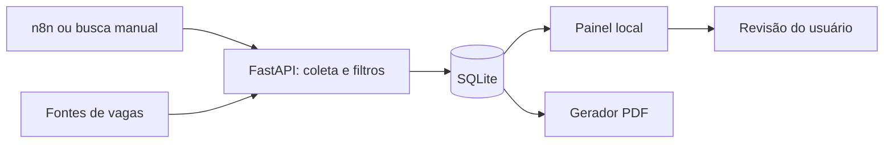

# JobFlow Local

Plataforma local para pesquisar vagas, aplicar critérios e acompanhar candidaturas em um único painel.

O projeto surgiu de uma rotina real: consultar vários sites, revisar requisitos, preparar currículos e controlar envios. Esta é a edição pública, com dados fictícios e sem histórico pessoal.

## O que funciona

- Coleta de vagas por HTML, API pública e RSS, conforme a fonte.
- Filtros por modalidade, remuneração, contrato, publicação e termos excluídos.
- Histórico em SQLite e estados separados: novas, pendentes, enviadas, ignoradas e ação necessária.
- Geração de currículo em PDF com dados declarados no arquivo local.
- Workflow importável do n8n para executar buscas periodicamente.
- API local usada pela [extensão complementar](https://github.com/mendxcyber/jobflow-browser-extension).



## Instalação

Requisitos: Docker Desktop com suporte à virtualização e Docker Compose. Python 3.12 é útil para preparar a configuração.

```bash
git clone https://github.com/mendxcyber/jobflow-local.git
cd jobflow-local
python scripts/setup.py
docker compose up -d --build
```

Se não tiver Python, copie manualmente `config/candidato.example.json` para `config/candidato.json` e `config/respostas.example.json` para `config/respostas.json`. Crie as pastas `dados` e `curriculos`.

Abra o painel em http://localhost:8090 e o n8n em http://localhost:5678. Conclua o cadastro local do n8n, importe `n8n/workflow.json` e execute manualmente antes de ativar o agendamento.

Os serviços usam portas locais já comuns. Se tiver outra instalação nessas portas, pare a instalação anterior ou ajuste o Compose antes de iniciar.

## Personalização

| Arquivo | Função |
| --- | --- |
| `config/candidato.json` | Dados pessoais, experiências, competências, idiomas e resumos escritos pelo usuário |
| `config/filtros.json` | Critérios de seleção; o exemplo inicial usa RJ/Zona Oeste e precisa ser revisado |
| `config/fontes.json` | Fontes automáticas e links de busca manual |
| `config/respostas.json` | Respostas previamente revisadas; inicia vazio |

Os arquivos pessoais, bancos e PDFs gerados estão no `.gitignore`. O resumo por área e a ordem das experiências são configuráveis; o sistema não valida se os dados declarados são verdadeiros.

## Fontes e limites

RioVagas, Gupy, Glassdoor, Vagas.com, InfoJobs, Trabalha Brasil e GeekHunter usam coletores que dependem do HTML disponível. Remote OK usa API pública e We Work Remotely usa RSS. Outros portais aparecem como links manuais. Uma fonte configurada não garante resultados: bloqueios, mudanças no HTML e limites de acesso podem interromper a coleta.

Vagas internacionais dos feeds ficam pendentes para revisão de elegibilidade, contrato e moeda. Valores estrangeiros não são tratados como reais. Os filtros são heurísticos e podem produzir falsos positivos ou negativos; revise cada oportunidade.

O sistema não resolve CAPTCHA, não realiza testes pelo candidato e não garante contratação ou aprovação ATS. A extensão é opcional e tem automação desativada por padrão na edição pública. Não use declarações ou consentimentos genéricos sem revisão.

## Desenvolvimento e testes

```bash
python -m venv .venv
# Ative a .venv conforme seu sistema.
python -m pip install -r worker/requirements.txt
python -m unittest discover -s tests -v
```

Para iniciar sem Docker, configure `DATA_DIR`, `OUTPUT_DIR` e `CONFIG_DIR` com caminhos locais e execute `uvicorn app:app --app-dir worker --host 127.0.0.1 --port 8090`.

## Segurança e autoria

Uso local por uma pessoa; sem autenticação para exposição pública. O Compose limita as portas a `127.0.0.1`. Não publique dados reais nem exponha a API à internet. Respeite as regras e limites de cada portal.

Desenvolvido por **mendxcyber**, com apoio de IA na implementação e documentação. A versão pública foi extraída do projeto pessoal e preparada com exemplos fictícios. Licença MIT para o código deste repositório; serviços e bibliotecas mantêm suas próprias licenças.

Veja [o anúncio do projeto](docs/ANNOUNCEMENT.md), [como contribuir](CONTRIBUTING.md) e [as limitações de segurança](SECURITY.md).
